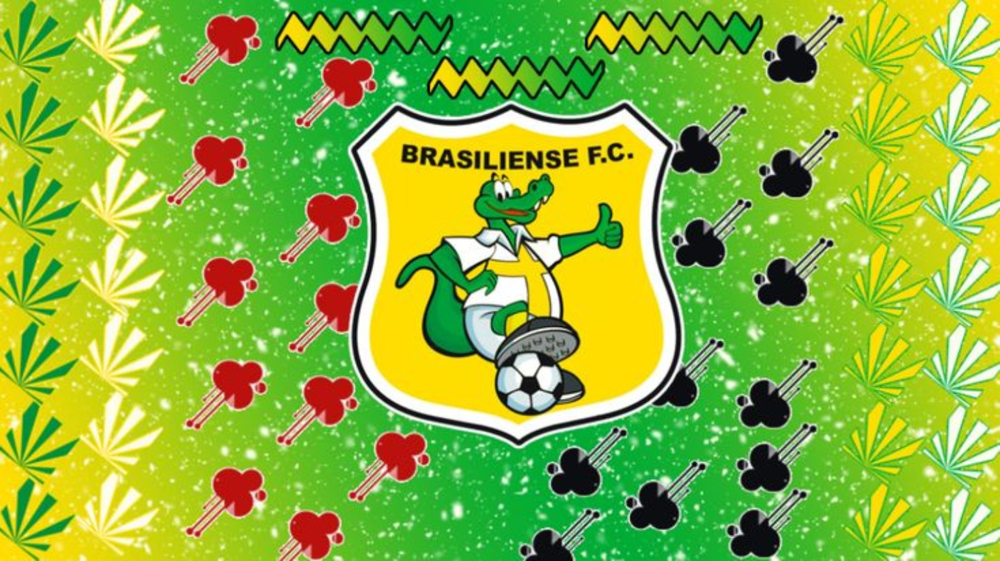

<div align="center">
  
</div>

<h1 align="center">VEO</h1>
<h2 align="center">I LOVE BRASILIENSE FC</h2>

<p align="center">
  Tecnologia, criatividade, programação e futebol.
  <br>
  Bem-vindo ao meu espaço no GitHub!
</p>

---

<h2 align="center">ABOUT ME</h2>

<p align="center">
  Estou aprendendo, explorando novas tecnologias e criando projetos.
  <br>
  Aqui compartilho meus estudos, experiências e ideias.
</p>

<h3 align="center">PROFILE DATA</h3>

```json
{
  "name": "VEO",
  "favorite_club": "Brasiliense FC",
  "interests": [
    "Programming",
    "Technology",
    "Football",
    "Project Development"
  ],
  "languages_and_formats": [
    "JavaScript",
    "HTML",
    "CSS",
    "JSON",
    "TSX",
    "PHP",
    "C#",
    "C++",
    "C",
    "Java",
    ".env"
  ],
  "tools": [
    "Git",
    "GitHub",
    "Visual Studio Code",
    "Windows 11",
    "Android"
  ]
}
```

---

<h2 align="center">TECHNOLOGIES & TOOLS</h2>

<p align="center">
  <a href="https://skillicons.dev">
    
  </a>
</p>

<p align="center">
  
  
  
</p>

---

<p align="center">
  <strong>BRASILIENSE FC: paixão que também faz parte de quem eu sou.</strong>
</p>

<p align="center">
  <a href="https://github.com/veo14269-jpg">VEO on GitHub</a>
  &nbsp;|&nbsp;
  <a href="https://skillicons.dev/">Skill Icons</a>
</p>
